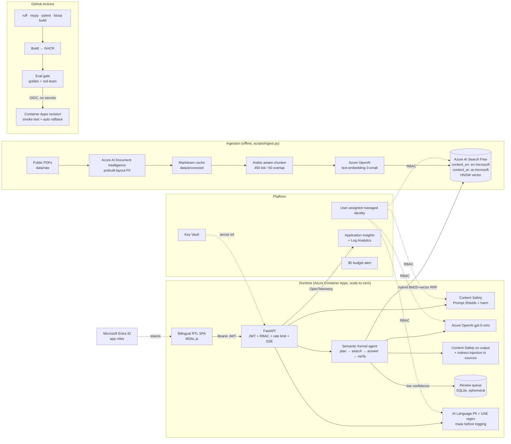
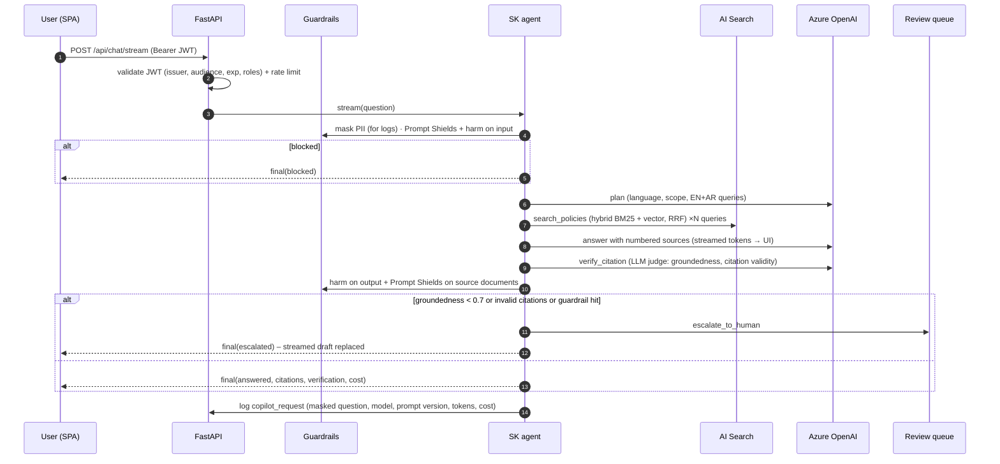

# Architecture

Reference implementation on **public** UAE government documents. Region: **UAE North** for every resource (see ADR-0007 for the one model-inference caveat).

## System view

## Components

| Concern | Azure / OSS service | Tier | Where |
|---|---|---|---|
| Document parsing | Azure AI Document Intelligence `prebuilt-layout` | F0 | `src/gov_copilot/ingestion/docintel.py` |
| Chunking | Custom, heading/page aware, Arabic sentence split | – | `src/gov_copilot/ingestion/chunker.py` |
| Embeddings | Azure OpenAI `text-embedding-3-small` (1536-d) | Standard (regional) | `src/gov_copilot/llm/clients.py` |
| Index + hybrid search | Azure AI Search, RRF fusion | Free | `src/gov_copilot/retrieval/` |
| Re-ranking | none / multilingual cross-encoder / Azure semantic ranker | config | `retrieval/rerankers.py` |
| Orchestration | Semantic Kernel plugin + deterministic workflow | – | `src/gov_copilot/agent/` |
| Generation + judge | Azure OpenAI `gpt-5-mini` | GlobalStandard | `agent/orchestrator.py` |
| Safety | Azure AI Content Safety (text analyze + Prompt Shields) | F0 | `guardrails_azure.py` |
| PII | Azure AI Language PII + UAE regex | F0 | `pii.py`, `guardrails_azure.py` |
| API | FastAPI, SSE, slowapi, PyJWT | – | `src/gov_copilot/api/` |
| Identity | Entra ID app roles; managed identity; GitHub OIDC | – | `api/auth.py`, `infra/scripts/setup-entra.sh` |
| Hosting | Azure Container Apps (consumption, min 0 replicas) | free grant | `infra/modules/app.bicep` |
| Secrets | Azure Key Vault (RBAC), Container Apps Key Vault references | Standard | `infra/modules/app.bicep` |
| Telemetry | OpenTelemetry → Application Insights / Log Analytics | 0.15 GB/day cap | `observability.py`, `observability/` |
| IaC | Bicep (subscription scope) | – | `infra/` |
| Private networking | VNet + private endpoints + DNS (flag, off) | – | `infra/modules/private-endpoints.bicep` |

## Request sequence

Note: tokens are streamed *before* verification completes; the UI replaces the draft if the final event is `escalated`/`blocked` (ADR-0011).
