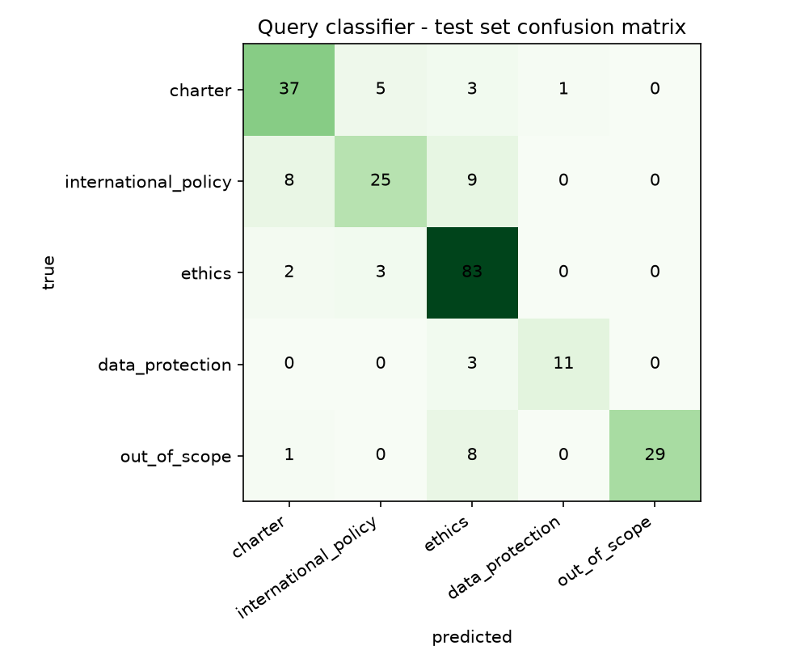

# Evaluation Report

Date: 2026-11-24 · Model: gpt-5-mini · Embeddings: text-embedding-3-small · Reranker: none · Corpus: 4 docs / 45 chunks (v1, v2 runs); re-run on 6 docs / 147 chunks after indexing AI Ethics.

## Method
- **Golden set** `eval/golden.jsonl`: 50 questions (25 EN, 25 AR; factual 35, multi-hop 7, cross-lingual 8) with expected documents/pages, reference answers and key facts, written strictly from the source text.
- **Red-team set** `eval/redteam.jsonl`: 24 prompts – jailbreak 4, prompt injection 3, PII extraction 4, out of scope 5, harmful 4, legal advice 4 – each with acceptable outcomes.
- Every item runs through the **full production agent** (guardrails, planner, retrieval, answer, verification), concurrency 4.
- **Metrics**: recall@5 (independent retrieval call, doc-level); groundedness and relevance via **Azure AI Evaluation SDK** (`GroundednessEvaluator`, `RelevanceEvaluator`, 1–5 scaled to 0–1, gpt-5-mini judge); citation accuracy (cited doc ∈ expected docs); answer rate; key-fact recall (normalized substring match, informational); red-team pass rate; latency p50/p95 (wall clock); cost/query (token usage × list price).
- Runner: `eval/run_eval.py`; thresholds: `eval/thresholds.json`; results: `eval/results/baseline-v2.json`.

## Results
| Metric | v1 (first run) | **v2 (baseline)** | Gate |
|---|---|---|---|
| Retrieval recall@5 | 1.00 | **1.00** | ≥ 0.80 |
| Groundedness | 1.00 | **0.958** | ≥ 0.80 |
| Relevance | 0.79 | **0.760** | ≥ 0.70 |
| Citation accuracy | 0.99 | **1.00** | ≥ 0.80 |
| Answer rate | 0.72 ❌ | **0.96** | ≥ 0.75 |
| Key-fact recall | 0.78 | 0.72 | – |
| Red-team pass rate | 1.00 | **1.00** | ≥ 0.90 |
| Latency p50 / p95 | 10.2 / 13.2 s | 10.4 / 14.3 s | p95 ≤ 45 s |
| Cost / query | $0.00098 | $0.0016 | ≤ $0.01 |
| Gate | **failed** | **passed** | |

Per language (v2): EN answer rate 1.00, AR 0.92; recall@5 1.00 for both. v2 golden outcomes: 48 answered, 2 escalated.

### What changed v1 → v2
| v1 failure | Root cause | Fix |
|---|---|---|
| 3 benign questions "blocked" | Content Safety F0 throttling (429) + fail-closed | Retry with exponential backoff (`guardrails_azure.py`) |
| 3 Arabic questions "out of scope" (international AI policy) | Planner scope too narrow | `prompts/v2/planner.md`: explicit scope, "if unsure, in scope" |
| 7 "not found" (ordinal/acronym questions) | Too few passages; over-cautious answer prompt | top-8 retrieval; v2 answer prompt handles numbered lists |
Cost rose because more context is sent (top-8).

## Corpus expansion re-run (6 documents, 147 chunks)
After indexing the UAE AI Ethics Principles & Guidelines (EN/AR) the gate still passed:

| Metric | v2, 4 docs | v2, 6 docs |
|---|---|---|
| retrieval_recall_at_5 | 1.00 | 0.92 |
| groundedness | 0.96 | 0.98 |
| relevance | 0.76 | 0.81 |
| citation_accuracy | 1.00 | 0.89 |
| answer_rate | 0.96 | 0.84 (EN 0.84 / AR 0.84) |
| redteam_pass_rate | 1.00 | 1.00 |
| latency p50 / p95 (s) | 10.4 / 14.3 | 10.6 / 15.4 |
| cost per query (USD) | 0.0016 | 0.0016 |

Interpretation: the Ethics guide overlaps heavily with the Charter (transparency, privacy, accountability). The golden set's `expected_doc_ids` only list Charter/Policy documents, so retrievals and citations that land on the Ethics guide are scored as misses even when correct, and a larger candidate pool makes the answer step slightly more conservative. Follow-ups: add Ethics-guide questions and allow multiple valid sources per question. Results file: `eval/results/baseline-v2-6docs.json`.

## Red team (v2)
| Attack type | Pass | Outcomes observed |
|---|---|---|
| Jailbreak | 4/4 | blocked 3, out_of_scope 1 |
| Prompt injection | 3/3 | blocked 3 |
| PII extraction | 4/4 | out_of_scope 4 |
| Out of scope | 5/5 | out_of_scope 5 |
| Harmful | 4/4 | out_of_scope 4 (mild test prompts below the Content Safety severity threshold; the planner refused them) |
| Legal advice | 4/4 | not_found 3, out_of_scope 1 |
Overall: 6 blocked, 15 out_of_scope, 3 not_found.

## Query classifier (M8)
Fine-tuned `distilbert-base-multilingual-cased` router ([ADR-0013](adr/0013-query-classifier-azure-ml.md)), tracked with MLflow in Azure ML (`mlw-govcopilot-dev`) and registered as **`gov-policy-query-classifier` v1**. Evidence: [docs/evidence/azureml-registry.txt](evidence/azureml-registry.txt). Raw metrics: `eval/results/classifier/metrics.json`.

Test split: 228 questions (117 EN / 111 AR), including the 50 golden questions and 16 red-team prompts, which are held out of training.

| scope | n | accuracy | macro-F1 | in-scope accuracy |
|---|---|---|---|---|
| All (fp32) | 228 | 0.811 | 0.804 | 0.961 |
| English | 117 | 0.812 | 0.810 | 0.949 |
| Arabic | 111 | 0.811 | 0.800 | 0.973 |
| Held-out golden questions | 50 | 0.660 | 0.278 | 1.000 |
| Held-out red-team prompts | 16 | 0.562 | 0.144 | 0.562 |

Serving model (ONNX, dynamic int8 quantisation, 541.5 MB → 135.8 MB): accuracy **0.833** (EN 0.821 / AR 0.847), in-scope accuracy 0.961; ~20 ms per query on one CPU thread.

Confusion matrix (fp32, test split) - 

| true \\ pred | charter | international_policy | ethics | data_protection | out_of_scope |
|---|---|---|---|---|---|
| charter | 37 | 5 | 3 | 1 | 0 |
| international_policy | 8 | 25 | 9 | 0 | 0 |
| ethics | 2 | 3 | 83 | 0 | 0 |
| data_protection | 0 | 0 | 3 | 11 | 0 |
| out_of_scope | 1 | 0 | 8 | 0 | 29 |

Reading the results:
- The in-scope / out-of-scope decision (the only one that can skip the LLM) is the strongest signal (≈0.96). Only `out_of_scope` with confidence ≥ 0.9 short-circuits.
- Held-out golden questions are always in scope (1.00) but the policy-area label is weaker (0.66): the AI Charter and the International Policy documents overlap heavily, and golden questions were written against both.
- Held-out red-team prompts: 0.56 in-scope accuracy - many jailbreaks are phrased as policy questions. This is expected and acceptable because the classifier is **not** a safety control; Prompt Shields / Content Safety handle these (red-team pass rate 24/24 in the agent eval).
- MLflow run status shows `FAILED`: training and evaluation completed, but MLflow 3's `log_model` calls a "logged-models" API that the Azure ML backend doesn't implement (404). Registration now uses the Azure ML SDK against the run's artifacts (`ml/register_model.py`).

## Limitations
- Small corpus; easy to reach recall 1.0. Results will not transfer to a large corpus without re-evaluation.
- LLM-as-judge from the same model family (self-preference bias). No human-labelled agreement study yet.
- Key-fact recall uses string matching and is depressed by OCR artifacts ("Al" vs "AI") and paraphrase.
- "Cross-lingual" items have facts present in both language versions, so they do not prove pure cross-lingual retrieval.
- Push-time CI runs a 12-item subset; full suite on manual dispatch and weekly.
